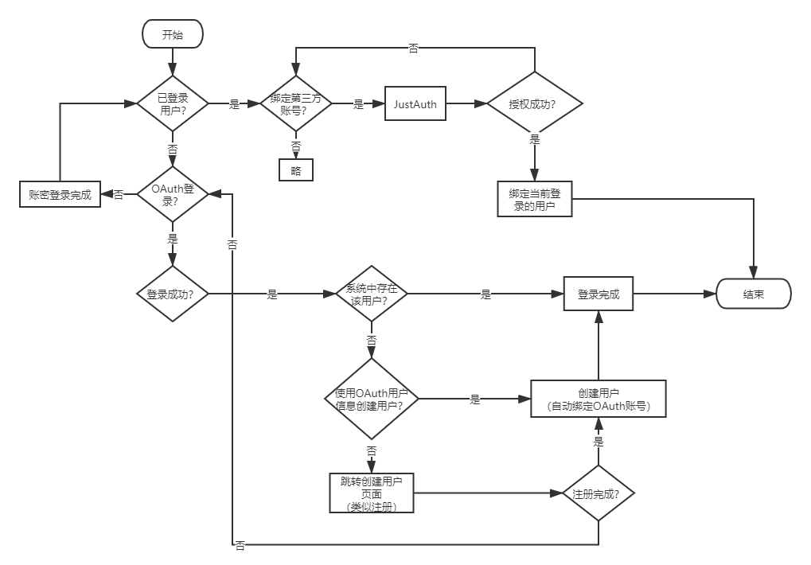

# XD11CC Single - 多租户 SaaS 后端框架

**[English](README_EN.md) | 中文**



一个基于 Spring Boot 2.7 构建的生产级多租户 SaaS 后端框架，采用 Java 8 开发，提供认证授权、实时通讯、任务调度、工作流引擎等开箱即用的企业级解决方案。

## 🌐 在线演示

**演示地址：** https://xd11ccc.cloud/xd11cc/login

> 演示账号：`待补充` / `待补充`

## 技术栈

| 层级 | 技术 | 版本 | 说明 |
|------|------|------|------|
| **基础框架** | Spring Boot | 2.7.18 | 应用框架 |
| **安全认证** | Spring Security + JWT | 5.7.x + 0.11.5 | 无状态认证，Redis 会话管理 |
| **社交登录** | JustAuth | 1.16.7 | OAuth2 第三方登录（GitHub/Google/微信等） |
| **ORM 框架** | MyBatis-Plus | 3.5.3.1 | 增强 CRUD + 自动填充 + 多租户拦截 |
| **分页插件** | PageHelper | 1.4.6 | 基于 ThreadLocal 的分页拦截 |
| **数据库** | MySQL | 8.0.33 | utf8mb4 + utf8mb4_0900_ai_ci |
| **连接池** | Druid | 1.2.24 | SQL 监控 + 慢查询检测 + 动态多数据源 |
| **缓存** | Redis + Redisson | 6.0+ / 3.36.0 | 分布式锁、限流、会话存储 |
| **消息队列** | RabbitMQ | 2.7.x | 异步解耦、事件通知 |
| **实时通讯** | Netty WebSocket | 4.1.x | 独立端口、长连接推送 |
| **任务调度** | XXL-JOB | 2.4.0 | 分布式定时任务、故障转移与失败重试 |
| **对象存储** | MinIO | 8.6.0 | 兼容 S3 协议的分布式存储 |
| **支付集成** | 支付宝 SDK + 微信支付 SDK | 4.40.831 / 4.8.0 | 多渠道支付客户端抽象 |
| **工作流引擎** | Flowable | 6.7.2 | BPMN 2.0 流程引擎，独立数据源 |
| **接口文档** | Swagger2 + Knife4j | 2.9.2 / 3.0.3 | 在线 API 文档 |
| **容器化** | Docker + Docker Compose | - | 一键部署 |
| **工具库** | Hutool / Fastjson2 / MapStruct / EasyExcel / TTL | 5.8.16 / 2.0.39 / 1.6.3 / 3.3.2 / 2.13.2 | 实用工具集 |

## 功能特性

### 🏗️ 核心架构

- **多租户隔离** — 共享数据库 + 行级隔离方案，通过 `TenantFilter` 解析域名/Header 获取租户 ID，`TransmittableThreadLocal` 自动传播租户上下文至异步线程，`MyBatis-Plus TenantLineInnerInterceptor` 自动追加 `WHERE tenant_id = ?` 条件
- **动态数据源** — 运行时通过 `@DataSource` 注解 + AOP 切面切换数据源，支持读写分离场景
- **RBAC 权限体系** — 完整的用户、角色、菜单、部门、岗位权限模型，支持细粒度权限控制
- **数据权限控制** — `@DataScope` 注解实现部门级/个人级数据权限隔离，基于 AOP 动态追加部门过滤条件
- **代码生成器** — 基于 Freemarker 模板引擎快速生成 CRUD 代码（Controller/Service/Mapper/Entity/VO/DTO）

### 🔐 安全模块

- **JWT 认证** — 无状态 Token 认证，JWT 作为 Redis Key 索引，服务端主动控制会话生命周期（踢人、刷新权限）
- **OAuth2 社交登录** — 集成 JustAuth，支持 GitHub、Google、微信等 20+ 社交平台登录
- **接口限流** — `@RequestLimit` 注解驱动，基于 Redisson RRateLimiter 实现令牌桶算法，支持 IP/用户/全局三种限流维度
- **RSA 加密** — 密码传输端到端加密，防止中间人窃取
- **验证码** — 图形验证码 + Redis TTL 过期机制，防暴力破解
- **CORS 跨域** — 统一跨域配置，支持白名单域名控制

### 📡 中间件集成

- **WebSocket 推送** — 基于 Netty 独立端口（12001）提供 WebSocket 服务，支持 Token 认证、心跳检测（30s）、空闲连接清理
- **消息队列** — RabbitMQ 集成，生产者 Confirm + Return 回调保证消息不丢，消费者手动 ACK 确保可靠消费
- **分布式调度** — XXL-JOB 集成，支持分片广播、故障转移、失败重试等企业级调度能力
- **分布式锁** — `@RedisLock` 注解驱动，基于 Redisson RLock 实现，支持 SpEL Key 动态锁粒度（ALL/KEY 两种模式），可配置等待超时、重试次数、自动释放时间
- **支付集成** — 统一 `PayClient` 接口抽象多渠道支付（支付宝 PC/WAP/扫码/APP/条码 + 微信 JSAPI/Native/WAP/App/条码），`@PayClientCode` 注解 + 工厂模式自动注册，支持统一下单、退款、回调解析
- **对象存储** — MinIO 文件上传/下载，预签名 URL 直传减轻后端带宽压力
- **PDF 转换** — Spire.PDF 集成，支持 PDF 转 Word 等文档格式转换

### 🔧 基础设施

- **全局异常处理** — 统一错误响应格式，模块化错误码设计（类型_模块_编号）
- **操作日志** — `@OperateLog` 注解自动记录操作日志，异步写入不影响主流程
- **登录日志** — 记录登录 IP、设备、时间、状态，支持审计追溯
- **请求监控** — Druid SQL 监控面板，慢查询自动检测告警
- **参数校验** — JSR-303 注解校验（`@Valid` + `@NotBlank`/`@NotNull` 等）
- **类型安全分页** — `PageResult<T>` 泛型封装分页结果，配合 `PageUtils.page()` 工具方法统一分页逻辑
- **线程池管理** — 专用线程池隔离（Netty 业务池、操作日志池、通知推送池），配合 `DelegatingSecurityContextExecutor` 传递安全上下文
- **Docker 部署** — Docker Compose 一键部署应用 + 中间件

### 🔄 工作流引擎（Flowable）

- **BPMN 2.0 设计器** — 基于 bpmn.js 的可视化流程设计，支持用户任务、网关、会签/或签多实例
- **引擎数据源隔离** — Flowable 使用独立 schema（`xd11cc_flowable`），与业务库分离，避免引擎表污染业务库
- **表达式配置中心** — 审批人、候选人、条件表达式通过 `expressionConfigKey` 配置化，BPMN 与业务人员解耦
- **流程定义管理** — 草稿保存/部署/版本管理/挂起激活/复制
- **审批流转** — 待办/已办、通过、驳回（支持退回到任意历史节点）、转办、撤回
- **候选人任务** — 支持 `candidateUsers` / `candidateGroups`，候选组映射为系统角色
- **实时通知** — 审批动作通过 WebSocket 推送（`WORKFLOW_APPROVED` / `WORKFLOW_REJECTED` 等事件）
- **多租户隔离** — 部署时显式传入 `tenantId`，引擎侧 `ACT_RE_*` / `ACT_RU_*` 均带租户标识

### 📊 业务模块

- **系统管理** — 用户、角色、菜单、部门、岗位、字典、配置、日志
- **租户管理** — 租户 CRUD、域名绑定、租户隔离配置
- **通知公告** — 系统公告发布、撤回、已读状态管理，支持 WebSocket 实时推送与未读数统计
- **工作流** — 流程分类、流程定义、流程设计、表达式配置、待办/已办审批
- **文件管理** — 文件上传/下载/预览（MinIO）
- **社交登录配置** — 第三方登录应用配置管理
- **在线用户** — 当前在线会话查看与强制下线

## 项目结构

```
src/main/java/com/xd11cc/single/
├── common/                            # 全项目共享的基础能力
│   ├── annotation/                    #   自定义注解
│   │   ├── DataScope.java             #     数据权限控制
│   │   ├── DataSource.java            #     动态数据源切换
│   │   ├── RedisLock.java             #     分布式锁
│   │   ├── RequestLimit.java          #     接口限流
│   │   ├── OperateLog.java            #     操作日志记录
│   │   ├── TenantIgnore.java          #     跳过租户过滤
│   │   ├── PayClientCode.java         #     支付渠道标记
│   │   └── PayClientScan.java         #     支付客户端扫描注册
│   ├── aspectj/                       #   对应 AOP 切面实现
│   ├── base/                          #   通用基类/接口 (ArrayValuable)
│   ├── auth/                          #   OAuth2 授权 (AuthRequestFactory)
│   ├── concurrency/                   #   线程池配置
│   ├── context/                       #   上下文持有者 (Tenant/DataSource/Permission)
│   ├── docs/                          #   Swagger/Knife4j 配置
│   ├── event/                         #   Spring 事件 (NoticeEvent 等)
│   ├── exception/                     #   ServiceException / ErrorCode
│   ├── initializer/                   #   启动初始化 (租户缓存预热)
│   ├── mq/                            #   RabbitMQ 队列配置
│   ├── properties/                    #   @ConfigurationProperties 属性类
│   ├── security/                      #   Spring Security 配置
│   └── web/                           #   Filter / Interceptor / 全局异常 / CORS
├── infrastructure/                    # 中间件与基础设施连接
│   ├── datasource/                    #   Druid 连接池 + 动态数据源
│   ├── mybatis/                       #   MyBatis-Plus 拦截器配置
│   ├── netty/                         #   Netty WebSocket 服务端
│   ├── redis/                         #   Redis 缓存 + 序列化配置
│   ├── schedule/                      #   XXL-JOB 定时任务
│   └── storage/                       #   MinIO 对象存储
├── modules/                           # 业务模块（垂直切分）
│   ├── pay/                           #   支付（PayClient 接口 + 支付宝/微信实现）
│   └── workflow/                      #   工作流引擎装配与业务扩展点
│       ├── FlowableConfig.java        #     引擎构建（独立数据源）
│       ├── FlowableWebMvcConfig.java  #     拦截器注册
│       ├── FlowableSecurityInterceptor.java  # Flowable 身份上下文
│       ├── AbstractWorkflowHandler.java      # 业务扩展点抽象类
│       ├── WorkflowHandlerFactory.java       # Handler 策略工厂
│       ├── WorkflowEvent.java                # 领域事件
│       └── WorkflowEventListener.java        # 事件 → WebSocket 推送
├── constants/                         # 应用常量 (CacheConstants/SecurityConstants)
├── controller/                        # REST API 控制器
├── convert/                           # MapStruct 对象转换器
├── entity/
│   ├── base/                          #   基础实体 (BaseDO/BaseTenantDO/ResponseVO/PageResult)
│   ├── domain/                        #   数据库实体 DO
│   ├── dto/                           #   数据传输对象（内部流转）
│   └── vo/                            #   视图对象（请求/响应）
├── enums/                             # 业务枚举 (SystemErrorEnum 等)
├── mapper/                            # MyBatis-Plus Mapper
├── service/                           # 业务逻辑接口
│   └── impl/                          #   Service 实现
└── utils/                             # 工具类
    ├── SecurityUtils.java             #   安全工具（当前用户/密码）
    ├── PageUtils.java                 #   分页工具（PageHelper 封装）
    ├── TreeUtils.java                 #   树形结构工具（O(n)）
    ├── ExcelUtils.java                #   Excel 导入导出（EasyExcel）
    ├── JwtUtils.java                  #   JWT 签发与解析
    ├── IpUtils.java                   #   IP 解析
    ├── RSAUtils.java                  #   RSA 加解密
    ├── TenantUtils.java               #   租户上下文工具
    └── ...                            #   其他工具类
```

### 分层依赖约定

```
controller → service → mapper → entity
     ↓           ↓
   common / infrastructure / modules
```

- `entity`、`utils`、`enums` 只依赖 `common`，不得依赖 `infrastructure` 或 `modules`
- `common` 与 `infrastructure` 之间保持单向，不得反向依赖 `service` / `controller`
- 新增业务模块放 `modules/<模块名>/`，不要塞进 `common` 或 `infrastructure`

## 快速开始

### 环境要求

| 组件 | 版本 | 是否必需 |
|------|------|----------|
| JDK | 8+ | ✅ 必需 |
| MySQL | 8.0+ | ✅ 必需 |
| Redis | 6.0+ | ✅ 必需 |
| RabbitMQ | 3.8+ | 可选 |
| MinIO | - | 可选（文件功能） |

> Flowable 使用**独立数据库** `xd11cc_flowable`，首次启动时通过连接串上的
> `createDatabaseIfNotExist=true` 自动创建，无需手工建库；`ACT_*` 表结构由引擎自动初始化。

### 本地开发

**1. 创建业务库并导入表结构**

```sql
CREATE DATABASE xd11cc_single DEFAULT CHARACTER SET utf8mb4 COLLATE utf8mb4_0900_ai_ci;
```

```bash
mysql -uroot -p xd11cc_single < doc/sql/xd11cc_single.sql
```

**2. 修改配置**

更新 `src/main/resources/application-dev.yml`：

- `spring.datasource.druid.master` — 业务库连接
- `spring.datasource.druid.flowable` — 流程引擎库连接
- `spring.redis` — Redis 连接

**3. 设置 JWT 密钥（必填）**

出于安全考虑，JWT 签名密钥**不允许硬编码**，必须通过环境变量或启动参数注入，长度 **≥ 32 字节**：

```bash
export SECURITY_TOKEN_SECRET="your-strong-secret-key-at-least-32-bytes"
```

未设置或长度不足时，应用会直接启动失败并给出明确提示。

**4. 启动**

```bash
mvn spring-boot:run
```

| 地址 | 说明 |
|------|------|
| `http://localhost:10001/xd11cc` | 应用根路径 |
| `http://localhost:10001/xd11cc/doc.html` | Knife4j 接口文档 |
| `http://localhost:10001/xd11cc/swagger-ui.html` | Swagger UI |
| `ws://localhost:12001/ws?token=xxx` | WebSocket 连接 |

> **注意**：若此前用旧包结构编译过，请先执行 `mvn clean`，避免 `target/classes`
> 残留旧包路径的 class 导致 Bean 冲突。

### 数据库脚本

| 脚本 | 用途 |
|------|------|
| `doc/sql/xd11cc_single.sql` | 完整初始化（建表 + 字典/菜单/分类等基础数据） |
| `doc/sql/migration/` | 增量迁移脚本，供已有环境按需执行 |

### 已有环境升级 Flowable

Flowable 的 `ACT_*` 表在首次连接 `xd11cc_flowable` 库时自动创建。若需手动控制建表时机，
可将 `application.yml` 中 `flowable.database-schema-update` 设为 `true` 启动一次，完成后改回 `false`。

### Docker 部署

```bash
# 打包
mvn clean package -DskipTests

# 构建镜像
docker build -t xd11cc-single .

# 启动
docker-compose up -d
```

## 接口概览

> 完整接口请访问演示环境的 Knife4j 文档。以下为各模块的主要入口。
> 所有接口均以 `/xd11cc` 为前缀（如 `/xd11cc/system/user/page`）。

### 认证授权 `/login`

| 方法 | 路径 | 说明 |
|------|------|------|
| GET | `/login/getCaptcha` | 获取图形验证码 |
| POST | `/login/loginByPassword` | 账号密码登录 |
| GET | `/login/getUserInfo` | 当前登录用户信息 |
| GET | `/login/getRoutes` | 当前用户动态路由菜单 |
| GET | `/login/authorize/{source}` | OAuth2 授权跳转 |
| GET | `/login/callback/{source}` | OAuth2 回调 |

### 系统管理

| 模块 | 主要接口 |
|------|----------|
| 用户 | `POST /system/user/page` · `/add` · `/modifyById` · `/list` · `GET /getById/{id}` · `/removeByIds/{ids}` · `POST /resetPassword/{id}` |
| 角色 | `POST /system/role/page` · `/add` · `/modifyById` · `GET /menuIds/{roleId}` · `/deptIds/{roleId}` |
| 菜单 | `GET /system/menu/list`（树形） |
| 部门 | `POST /system/dept/treeList` · `/add` · `/modifyById` |
| 岗位 | `POST /system/post/page` |
| 字典 | `POST /system/dictType/page` · `POST /system/dictData/page` |
| 配置 | `POST /system/config/page` |
| 租户 | `POST /system/tenant/page` · `/add` · `/modifyById` |
| 在线用户 | `GET /system/onlineUser/list` · 强制下线 |

### 通知公告

| 方法 | 路径 | 说明 |
|------|------|------|
| POST | `/system/notice/page` | 通知分页 |
| POST | `/system/notice/publish/{id}` | 发布通知（触发 WebSocket 推送） |
| POST | `/system/notice/revoke/{id}` | 撤回通知 |
| POST | `/system/notice-user/myPage` | 我的通知 |
| GET | `/system/notice-user/unreadCount` | 未读数统计 |
| POST | `/system/notice-user/markAsRead/{noticeId}` | 标记已读 |

### 工作流 `/workflow`

| 模块 | 主要接口 |
|------|----------|
| 流程分类 | `POST /workflow/category/page` · `/add` · `/modifyById` · `GET /list` |
| 流程定义 | `POST /workflow/draft/save` · `/draft/deploy` · `GET /draft/{modelId}` · `POST /definition/page` · `/definition/suspend` · `/definition/activate` |
| 表达式配置 | `POST /workflow/expression-config/page` · `/add` · `GET /options` |
| 流程实例 | `POST /workflow/process/start` · `/mine` · `/cancel` · `GET /process/{processInstanceId}` |
| 审批任务 | `POST /workflow/task/todo` · `/done` · `/task/approve` · `/task/reject` · `/task/delegate` · `GET /task/rejectable-nodes` |

### 其他

| 模块 | 主要接口 |
|------|----------|
| 文件 | `POST /file/upload` · `/upload/batch` · `/download` |
| 代码生成 | `POST /generate/code/page` · `GET /generate/code?tableName=xxx` |
| 社交登录配置 | `POST /auth/client/config/page` |

## 架构亮点

### 多租户数据隔离

```
请求 → TenantFilter (从域名/Header提取租户ID)
     → TenantContextHolder (存入 TransmittableThreadLocal，自动传播至异步线程)
     → JwtAuthenticationTokenFilter (JWT认证)
     → TenantDatabaseInterceptor (MyBatis-Plus TenantLineInnerInterceptor 自动追加 WHERE tenant_id = ?)
     → 业务逻辑执行
     → TenantContextHolder.clear() (finally 块清理，防止线程池复用污染)
```

**关键设计**：
- `TransmittableThreadLocal` 解决线程池复用时的租户上下文丢失问题
- `@TenantIgnore` 注解 + AOP 支持特定方法跳过租户过滤（如超管跨租户查询）
- `TenantUtils.executeIgnore()` 编程式忽略
- 逻辑删除字段 `del_flag = NULL` 配合唯一索引 `(xxx, tenant_id, del_flag)`，NULL 不参与判重，允许删除后重建同名记录

### 认证流程

```
登录请求 → LoginService.loginByPassword()
        → UserDetailServiceImpl.loadUserByUsername() (Spring Security 认证)
        → BCryptPasswordEncoder 密码校验
        → JWT Token 生成 (UUID 作为 Redis Key)
        → Redis 存储 LoginUserDTO (TTL 过期自动失效)
        → 返回 Token

后续请求 → JwtAuthenticationTokenFilter
        → 从 Header 提取 Token
        → Redis 查询 LoginUserDTO
        → 验证 Token 有效期 (剩余时间 < 阈值时自动续期)
        → 构建 UsernamePasswordAuthenticationToken
        → 设置 SecurityContextHolder
        → 继续 FilterChain
        → finally: TenantContextHolder.clear()
```

**关键设计**：
- JWT 作为 Redis Key 索引，服务端可主动踢人/刷新权限
- Token 续期在 Filter 层完成，客户端无感知
- 完全无状态（`SessionCreationPolicy.STATELESS`）

### 接口限流

```java
@RequestLimit(key = "login:", time = 60, count = 10, type = RequestLimitEnum.IP)
@PostMapping("/login/loginByPassword")
public ResponseVO<String> loginByPassword(...) { ... }
```

**实现原理**：
- `@RequestLimit` 注解 + `RequestLimitAspect` AOP 切面
- Redisson `RRateLimiter` 令牌桶算法（分布式场景多实例共享配额）
- 支持 `IP`/`USER`/`DEFAULT` 三种限流维度
- Key 格式：`request_limit:{prefix}{key}{dimension}:{identifier}`

### 分布式锁

```java
@RedisLock(prefix = "order:pay", key = "#orderId", waitTime = 3, leaseTime = 30)
public void processPayment(String orderId) { ... }
```

**实现原理**：
- `@RedisLock` 注解 + `RedisLockAspect` AOP 切面
- Redisson `RLock` 可重入锁实现
- 支持 `ALL`（所有入参拼接为锁维度）/ `KEY`（按 SpEL 表达式指定锁维度）两种粒度
- 可配置参数：`waitTime`（获取等待超时）、`leaseTime`（自动释放时间）、`retryTimes`（重试次数）
- Lock Key 格式：`redlock:{prefix}:{declaringClass}.{methodName}:{resolvedValue}`
  - KEY 模式（key 非空）：`resolvedValue` 为 SpEL 解析结果，如 `redlock:tenant:add:SystemTenantServiceImpl.add:example.com`
  - ALL 模式（key 为空）：`resolvedValue` 为所有入参用 `|` 拼接

### 支付客户端架构

```
支付请求 → PayClientFactory.getPayClient(channel)
        → PayClient.unifiedOrder(reqDTO)      // 统一下单
        → PayClient.parseOrderNotify(...)     // 渠道回调解析
        → PayClient.unifiedRefund(reqDTO)     // 统一退款
        → PayClient.parseRefundNotify(...)    // 退款回调解析
```

**关键设计**：
- `PayClient<Config>` 泛型接口统一支付宝/微信等渠道差异
- `@PayClientCode(PayChannelEnum.ALIPAY_WAP)` 注解标记渠道实现类
- `PayClientScannerRegistrar` 启动时扫描并注册到 `PayClientFactory`
- `AbstractAlipayPayClient` / `AbstractWxPayClient` 封装 SDK 公共逻辑
- 已接入渠道：支付宝（PC/WAP/扫码/APP/条码）、微信（JSAPI/Native/WAP/App/条码）

### 线程池设计

```java
// Netty 业务线程池 (IO密集型)
@Bean("nettyTaskExecutor")
corePoolSize = CPU_CORES, maxPoolSize = CPU_CORES * 2
拒绝策略 = DiscardPolicy (WebSocket 消息可容忍丢失)
包装 = TtlExecutors.getTtlExecutor() (传递 ThreadLocal)

// 操作日志线程池 (数据不可丢)
@Bean("operateLogExecutor")
corePoolSize = CPU_CORES / 2, maxPoolSize = CPU_CORES
拒绝策略 = CallerRunsPolicy (背压到调用线程，确保日志不丢)
包装 = DelegatingSecurityContextExecutor + TTL (传递 SecurityContext + ThreadLocal)

// 通知推送线程池
@Bean("noticeTaskExecutor")
corePoolSize = CPU_CORES / 2, maxPoolSize = CPU_CORES
拒绝策略 = CallerRunsPolicy
包装 = TtlExecutors.getTtlExecutor()
```

**关键设计**：
- 专用线程池隔离，避免不同业务互相影响
- `DelegatingSecurityContextExecutor` 传递 SecurityContext 至异步线程
- `TtlExecutors.getTtlExecutor()` 传递 TransmittableThreadLocal
- 拒绝策略选择原则：数据可丢 → Discard；数据不可丢 → CallerRuns

### Netty WebSocket 架构

```
客户端连接 → BossGroup(1线程) 接受连接
          → WorkerGroup(N线程) 处理读写
          → Pipeline 处理链:
              1. HttpServerCodec (HTTP编解码)
              2. ChunkedWriteHandler (大数据分块)
              3. HttpObjectAggregator (HTTP聚合)
              4. IdleStateHandler (30s读空闲/60s写空闲检测)
              5. WebSocketServerProtocolHandler (WebSocket握手)
              6. WebSocketAuthHandler (自定义Token认证)
              7. WebSocketServerHandler (业务消息处理)
          → ChannelManager 管理用户连接映射 (userId ↔ Channel)
```

**关键设计**：
- 独立端口（12001），不与 HTTP 请求互相影响
- Reactor 多线程模型，单机可支撑万级连接
- TCP 参数优化：`TCP_NODELAY=true` 禁用 Nagle 算法降低延迟
- 心跳机制：30s 未收到客户端消息 → 主动断开死连接

### 数据权限控制

```java
@DataScope(deptAlias = "d", userAlias = "u")
@PostMapping("/system/user/page")
public ResponseVO<PageResult<SystemUserVO>> page(...) { ... }
```

**实现原理**：
- `@DataScope` 注解 + `DataScopeAspect` AOP 切面
- 根据当前用户的数据权限级别动态追加 SQL 条件：
  - 全部数据权限：不追加
  - 自定义数据权限：`WHERE d.id IN (1,2,3)`
  - 本部门数据权限：`WHERE d.id = #{deptId}`
  - 本部门及以下：`WHERE d.id IN (递归查询子部门)`
  - 仅本人数据：`WHERE u.id = #{userId}`

### 工作流集成架构

```
                    ┌─────────────────────────────┐
   设计器(bpmn.js) ─→│  /workflow/draft/save       │  草稿存 ACT_RE_MODEL
                    │  expressionConfigKey 解析   │  审批人配置化
                    └──────────────┬──────────────┘
                                   ↓ deploy
                    ┌─────────────────────────────┐
                    │  ACT_RE_PROCDEF (tenantId)  │  引擎库 xd11cc_flowable
                    └──────────────┬──────────────┘
                                   ↓ start
    发起方 ──────────→│  workflow_instance（业务库）  │  业务关联 + 状态机
                                   ↓
    审批人 ──────────→│  待办查询（assignee/候选人）  │
                    │  通过 / 驳回 / 转办          │
                    └──────────────┬──────────────┘
                                   ↓ 发布领域事件
                    WorkflowEvent → WorkflowEventListener
                                   ↓ @Async + AFTER_COMMIT
                          WebSocket 推送审批通知
```

**关键设计**：

- **双数据源隔离** — 引擎表（`ACT_*`）位于 `xd11cc_flowable` 库，业务表位于 `xd11cc_single` 库，
  避免引擎升级时误伤业务数据；两者通过 `process_instance_id` 关联。
- **租户显式传递** — Flowable 6.7.2 无 ThreadLocal 租户注入机制，
  部署与查询均由业务层显式传 `tenantId`，引擎侧数据天然按租户隔离。
- **表达式配置中心** — BPMN 中不直接写死审批人，而是声明 `expressionConfigKey`，
  部署时由 `WorkflowExpressionResolver` 解析为真实表达式，让业务人员可在页面上维护审批规则。
- **业务扩展点** — `AbstractWorkflowHandler` 提供 `onProcessStart` / `onTaskApprove` / `onProcessComplete`
  等回调，业务方按 `processDefinitionKey` 注册即可挂接业务逻辑；未注册时自动使用空实现，不阻断流程。
- **事务边界明确** — 审批事件使用 `@TransactionalEventListener(AFTER_COMMIT)`，
  确保数据库提交成功后才推送，避免“推送了但数据回滚”。
- **候选人支持** — 待办查询同时覆盖 `assignee`、`candidateUsers`、`candidateGroups`，
  候选组以系统角色 ID 映射，避免候选人任务无人可见。

## 许可证

详见 [LICENSE](LICENSE)。
